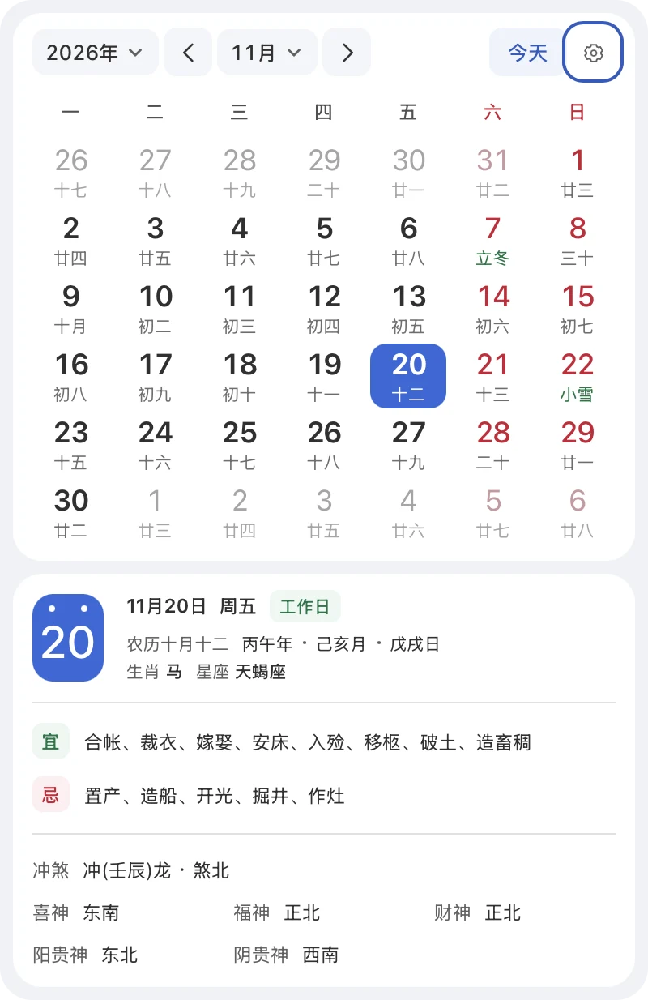
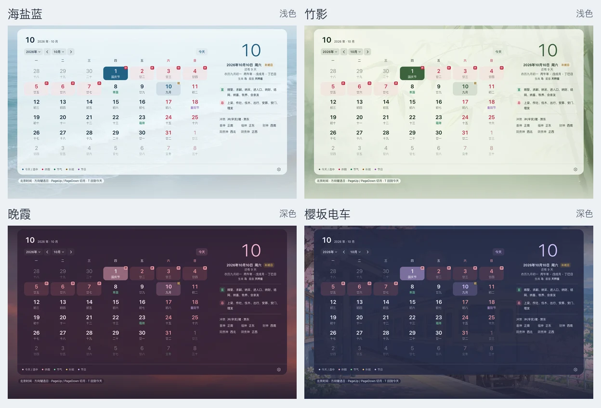

# i日历


春节从哪天开始放假？这个周六要补班吗？打开 i日历，公历、农历、节气和放假调休都在一张月历上。免费、无广告，无需登录。

[打开网页版](https://cixiangtao.github.io/i-calendar/) · [下载 Mac 版](https://github.com/cixiangtao/i-calendar/releases/latest) · [反馈问题](https://github.com/cixiangtao/i-calendar/issues)


## 查一个日子

- **看这个月怎么过。** 月历格里可见农历、节日、节气和休班标记。点日期可查看距今还有几天或已过去几天，以及干支、生肖、星座、每日宜忌、冲煞和方位。
- **算两个日子隔多久。** 从设置页底部的计算器图标打开日期计算，可查日期间隔、向前或向后推算、按放假调休统计工作日。结果可直接跳回月历。
- **查几点天亮、几点日落。** 在设置中选城市或启用定位，可查看所选日期的日出、日落和白昼时长。

<p>
  
  
</p>

上图为 Mac 菜单栏窗口和手机浏览器截图。iOS 版正在开发。

## 给日历换个主题

在「设置 → 外观 → 主题」中切换，共有 9 款内置主题。清爽白是默认主题，暖纸色、雾灰蓝和暮紫也采用纯色配色。山雾、海盐蓝、竹影、晚霞和樱坂电车带有图片背景，画面会从半透明的卡片后透出来。每款主题都有浅色和深色配色，也可以跟随系统切换。



用「自定义主题」可以编辑浅深色配色和卡片透明度，也可以添加本地图片或 HTTPS 图片直链。编辑时点「查看月历」能看到整张日历的效果，返回后可继续调整。主题可以导出为 ZIP 分享，旧版 `.icaltheme` 和 JSON 主题包也支持导入。[查看主题包格式](docs/主题模型.md#交换文件)

## 安装 Mac 版

当前版本 **2.4.0**。Mac 安装包适用于 Apple 芯片（arm64）和 macOS 13 或更新版本。解压后把「i日历」拖进「应用程序」，打开后从系统菜单栏使用。右键菜单栏图标可直达设置和日期计算。[打开正式版下载页](https://github.com/cixiangtao/i-calendar/releases/latest)

应用采用 ad-hoc 本地签名，尚未通过 Apple 公证。若 macOS 提示无法验证开发者，请核对 Release 提供的 SHA-256，再到「系统设置 → 隐私与安全性」选择「仍要打开」。[应用内更新说明](docs/自动更新.md)

## 数据从哪里来

- 中国大陆全国放假调休采用 [holiday-cn](https://github.com/NateScarlet/holiday-cn) 数据，并保留各年度官方通知链接。普通周末、放假和补班分别标记，尚未收录的年份会明确提示。网页版需要联网打开，Mac 版可离线查询已收录的数据。
- 公农历、节气与黄历使用 `lunar-typescript` 在本地计算，日期以北京时间为准。黄历用于了解传统习俗，宜忌随流派而异。[查看黄历数据与口径](docs/黄历数据与口径.md)

## 本地开发

使用 Node.js 24 LTS（至少 24.15.0）与 Corepack。Corepack 会按仓库配置选用锁定的 pnpm 12.18.0。Mac 开发还需要 Xcode Command Line Tools 和 rustup。

```sh
corepack pnpm install --frozen-lockfile
corepack pnpm run dev:web   # 网页预览
corepack pnpm run dev:mac   # 或启动 Mac 菜单栏开发版
corepack pnpm run check     # lint、格式、类型、测试和构建
```

Mac 开发版与正式版可同时运行。原生验证使用 `pnpm run check:native`、`pnpm run build:mac` 和 `pnpm run check:mac`。iOS 开发需要完整 Xcode 和 iOS SDK，初始化入口为 `pnpm run ios:init`。

Mac、iOS 与 Web 复用日历核心与 React 界面，原生壳使用 Tauri 2。查看[架构说明](docs/ARCHITECTURE.md)、[核心 API](packages/calendar-core/README.md)、[验证记录](docs/验证记录.md)和[发布约定](docs/发布约定.md)。

项目采用 [MIT 许可证](LICENSE)。第三方依赖及资源见[第三方许可声明](THIRD_PARTY_NOTICES.md)。
