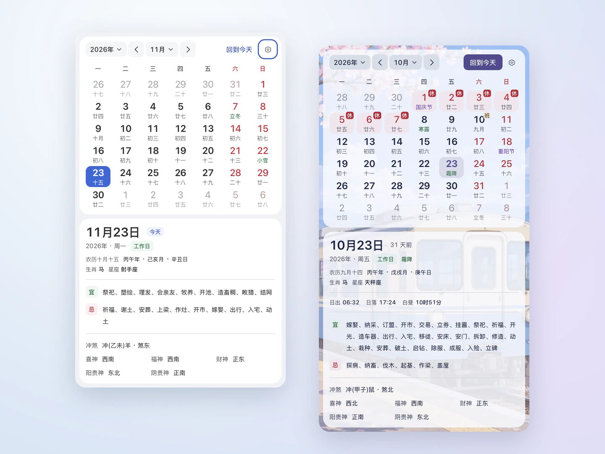

<h1 align="center">i日历</h1>

<p align="center">一款轻量的 Mac 菜单栏日历。随手查看公历、农历、节气和中国大陆放假调休。</p>

<p align="center">
  <a href="https://github.com/cixiangtao/i-calendar/releases/latest">下载 Mac 版</a>
  · <a href="https://cixiangtao.github.io/i-calendar/">使用网页版</a>
</p>



## 日历功能

- **公农历与放假调休。** 菜单栏一点即开。月历标出传统节日、节气、放假和补班，已收录的数据可以离线查看。
- **日期详情与计算。** 选中一天可查看黄历、日出日落和白昼时长。支持计算日期间隔、前后推算和统计工作日。
- **主题与外观。** 内置纯色和图片主题，支持浅色、深色及跟随系统。自定义配色和背景后，可导出主题包分享。

Mac 和网页版均免费、无广告、无需登录。

## 安装 Mac 版

当前版本 **2.5.1**，适用于 **Apple 芯片（arm64）和 macOS 13 或更新版本**。

1. 从[正式版下载页](https://github.com/cixiangtao/i-calendar/releases/latest)下载 ZIP。
2. 解压后将「i日历」拖入「应用程序」，打开后点击菜单栏图标。

### Homebrew

Homebrew 会下载并校验同一份正式版安装包。

```sh
brew tap cixiangtao/i-calendar https://github.com/cixiangtao/i-calendar.git
brew install --cask cixiangtao/i-calendar/i-calendar
```

安装包采用 ad-hoc 签名，尚未通过 Apple 公证。如果 macOS 提示无法验证开发者，请核对安装包的 SHA-256，再到「系统设置 → 隐私与安全性」选择「仍要打开」。[应用内更新说明](docs/自动更新.md)

## 数据与项目

中国大陆放假调休数据来自 [holiday-cn](https://github.com/NateScarlet/holiday-cn)，并保留官方通知链接。公农历、节气与黄历由 `lunar-typescript` 在本地计算，日期以北京时间为准。[查看黄历数据与口径](docs/黄历数据与口径.md)

Mac 与 Web 共享日历核心和 React 界面，Mac 客户端基于 Tauri 2。iOS 版正在开发。

[反馈问题](https://github.com/cixiangtao/i-calendar/issues) · [架构说明](docs/ARCHITECTURE.md) · [核心 API](packages/calendar-core/README.md) · [主题包格式](docs/主题模型.md#交换文件)

## 本地开发

安装 Node.js 24 LTS（至少 24.15.0）与 Corepack。开发 Mac 客户端还需要 Xcode Command Line Tools 和 rustup。

```sh
corepack pnpm install --frozen-lockfile
corepack pnpm run dev:web
corepack pnpm run dev:mac
corepack pnpm run check
```

[验证记录](docs/验证记录.md) · [发布约定](docs/发布约定.md) · [MIT 许可证](LICENSE) · [第三方许可声明](THIRD_PARTY_NOTICES.md)
