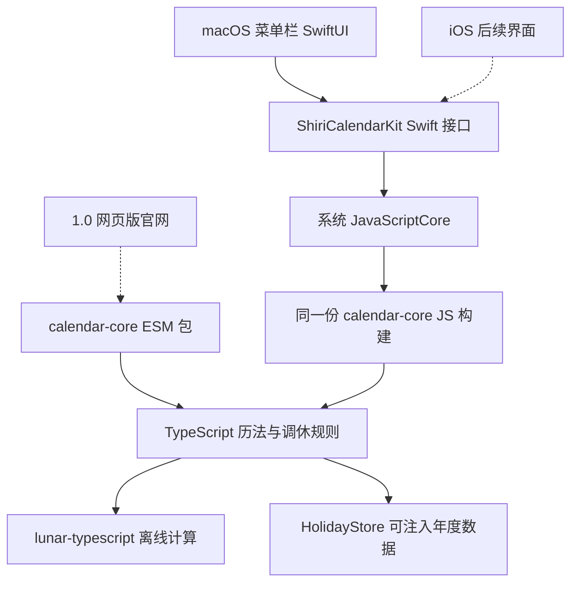

# 核心能力与界面边界

- 算法仅有一份。Swift 负责类型桥接，不重写农历/节气/节日或休班规则。
- `calendar-core` 不读取文件、不联网、不接触 UI、不决定何时更新。
- `ShiriCalendarKit` 是 macOS/iOS 共享 Swift Package，约 344KB JS 资源运行于系统引擎，不携带 WebView 或 Electron。
- Mac 适配层负责缓存、用户手动更新、导入面板和设置；SwiftUI 仅绑定模型。
- 所有查询返回可 JSON 序列化的数据，将来可直接包装 CLI/HTTP 服务，不要求界面应用常驻。
- 年度调休数据必须来自完整通知。校验器验证结构，不伪装成可以自动证明政策完整性。

## 已实现的公共能力

- 严格公历日期及显式时区转换，支持 1901—2100。
- 公农历对照、闰月、干支年/生肖、常见节日、二十四节气。
- 月历六周网格，可周一/周日开始。
- 普通周末、正常工作日、官方放假、周末补班，附数据覆盖状态与来源。
- 后续节气/节日及下一段连休假期查询。
- 数据结构校验、原子替换、年度导入/导出和跨年覆盖。

## 目前没有实现

- iOS 界面、Widget 与真机验证。
- 独立 Web 页面（ESM 核心可直接用于 Web）。
- 提醒、农历生日、个人日程、账号同步、地方假期、黄历宜忌。
- 安装包公证、Mac App Store/TestFlight 分发。
