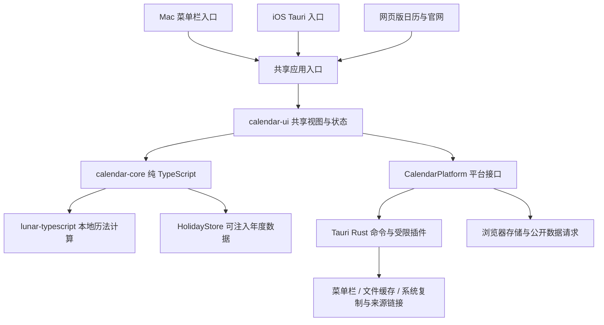

# 核心能力与界面边界

i日历使用 Tauri 2 承载 Mac 与 iOS，共享 React 界面直接用于 Web。历法及调休规则仍只有一份 TypeScript 实现。

## 三层职责

| 层             | 位置                     | 负责内容                                 | 依赖限制                             |
| -------------- | ------------------------ | ---------------------------------------- | ------------------------------------ |
| 日历核心       | `packages/calendar-core` | 公农历、节气、节日、月历、调休校验及查询 | 无 UI、网络、文件系统和平台依赖      |
| 界面与应用状态 | `packages/calendar-ui`   | 六周网格、选日、偏好、更新流程、导入反馈 | 通过注入接口调用宿主，规则只调用核心 |
| 平台适配       | `apps/calendar`          | 浏览器/Tauri 启动、存储、网络和系统能力  | 不复制历法规则，不维护另一套月历界面 |

`CalendarController` 不依赖 React，以稳定快照和订阅接口供视图使用；保存操作串行执行，避免旧偏好覆盖新偏好。跨北京时间午夜时，跟随今天的选择继续跟随，手动浏览的日期保留。缓存失效时回退内置数据并显示原因。

`color-theme.ts` 负责 UI 中性色、强调色和明暗适配，与历法核心独立。用户保存预设标识及原始 `#RRGGBB` 强调色，渲染时生成可读的文字、选择背景和叶片色，并同步给 CSS 与 Ant Design。偏好仍使用 schemaVersion 1，旧记录缺少新增字段时补齐默认值；非法主题或颜色拒绝载入，原始文件保留。增加对比度偏好由同一配色规则响应。

`CalendarSelect` 是共享 UI 中的受控单选组件，包装已有 Ant Design Select，供年份、月份与菜单栏时间格式复用。业务只传值、纯文本选项、可访问名称和变更回调；视觉及列表键盘行为集中维护。列表渲染在同一 WebView 中，不再按系统原生选择器处理，不占用原生交互忙碌标记；窗口失焦仍能正常收起日历。详细接口见[选择器组件](选择器组件.md)。

设置使用共享 Ant Design Tabs 分为常规、菜单栏、数据、关于；菜单栏标签仅在 Mac 创建，标签状态属于视图，不写入日历核心或持久化偏好。隐藏的已访问面板不销毁，保留格式草稿与滚动位置；只有活动面板参与可访问和焦点顺序。文件输入始终挂载在 Tabs 外，保持原生文件选择取消的监听有效；更新、导入和保存反馈也位于 Tabs 外，切页后仍可见。返回栏、标签与页脚固定，各面板独立滚动。

黄历由核心独立的 `getAlmanac(date)` 返回，包含干支、完整宜忌、冲煞、方位与来源/口径元信息；不放进每个 `CalendarDay` 或 42 格月历。控制器只随所选日期同步一份黄历，界面复用同一内容组件，所有尺寸直接展示同一份内容，Mac 在月历下方、宽屏网页在右栏完整展开详情，取消卡片内滚动，网页自然纵向滚动。Mac 共享视图通过 ResizeObserver 观察内容尺寸，经可选平台接口 `setPopupHeight` 请求逻辑像素高度，宿主按菜单栏所在屏幕工作区裁切高度并定位，屏幕不足时整个日历滚动。设置目标高度维持 660px；期望高度仅保留在原生内存中，每次重新打开时适配当前屏幕，不进入公共历法核心或用户偏好。应用不维护后续事件推荐状态；核心的事件/假期查询 API 仍可供其他客户端复用。黄历不依赖年度调休覆盖，不进行网络请求或持久化。固定口径见[黄历数据与口径](黄历数据与口径.md)。

年月日干支在日期摘要中紧接农历日期展示，读取同一份 `state.almanac.ganZhi`；去除农历文本中重复的干支年。`AlmanacContent` 展示宜忌、冲煞与方位，不再单独重复干支。该调整仅改变呈现位置与密度，不修改历法算法、固定口径或数据返回结构。

Mac 使用系统 WKWebView，不携带 Chromium。Rust 只处理菜单栏、窗口位置、文件存储和固定来源的网络请求；iOS 复用相同入口与 `mobile_entry_point`，通过独立平台配置避免引入 Mac 菜单栏行为。Web 使用浏览器 localStorage、Fetch 和 Clipboard，不启动 Rust 服务端。

Mac 菜单栏时间由 `src-tauri/src/menu_clock.rs` 的原生线程维护，使用系统本地时区，不依赖 WebView 可见状态或 JavaScript 定时器；格式包含秒时按秒边界刷新，其余按分钟边界刷新，仅在标题变化时更新文字。偏好修改立即唤醒线程，重新打开窗口与原生恢复事件也触发刷新。关闭时间显示仅清空标题，图标保留。

`preferences.menuClock.showIcon` 控制图标显隐，旧记录缺字段时补齐为 true。TypeScript 与 Rust 共用显隐样例并拒绝同时隐藏图标和时间；图标隐藏时还需确保格式产生非空白文字。原生线程仅在图片状态变化时更新图标，隐藏前先设置有效标题、清空标题前先恢复图标；图片与模板属性通过同一次 API 更新，避免恢复时闪烁。空白输出的运行时兜底保留图标，入口对象和事件处理不重建。冒烟检查经主线程读取真实 `NSStatusBarButton` 的图片、模板属性、文字和按钮尺寸。

`calendar-ui/src/menu-clock.ts` 提供格式校验、预设及设置页预览；这属于显示偏好，不进入历法核心。Rust 与 TypeScript 读取同一份样例，校验补零、12 小时制、中文星期、固定文字、非法格式与显隐组合。`preferences.menuClock` 随既有 schemaVersion 1 状态保存，旧记录缺少全部菜单栏设置时采用图标和时间均开启及 `HH:mm` 默认值。iOS 与 Web 保留偏好结构兼容，不展示 Mac 专属设置。详细契约见[菜单栏时间格式](菜单栏时间格式.md)。

## 平台能力与权限

- Mac 菜单栏左键切换，右键提供打开、设置和退出；关闭与失焦收起窗口，进程常驻。
- Mac 悬浮窗的原生内容视图使用 20px 圆角与边界裁切，窗口背景透明、系统阴影保留；仅使用 AppKit/Core Animation 公开 API，不启用 Tauri 的 macOS 私有透明接口。初始化在主线程执行，冒烟检查也通过主线程回调读取原生状态。
- 弹层按菜单栏位置与显示器物理坐标定位，并限制在屏幕内；原生选择器/导入面板期间暂停失焦收起。
- 原生状态只写入固定应用数据目录，采用大小限制、版本校验和原子替换；不开放通用文件系统或 shell 权限。
- 调休请求只接受年份，不接受任意 URL。Rust 固定请求 holiday-cn 的公开 JSON，设置超时及大小上限。
- 来源链接只允许 HTTPS，复制只授予写入文本能力。生产 CSP 限制脚本来源；开发 CSP 单独允许 Vite 热更新。
- 开发与本机构建流程不包含自动更新、统计、账户或遥测。

## 数据更新与迁移

应用初始化先载入内置完整年份，再校验并合并本地缓存。Mac 当前数据目录为 `Application Support/local.icalendar.app`；新状态缺失时先只读导入旧 Tauri 标识目录 `local.shiri.calendar` 中的完整状态，包含配色和菜单栏格式，再回退到旧 Swift 版的调休文件和显示偏好。原文件不删除，后续保存仅写新目录。已存在但损坏的新状态不会被旧数据静默替代。

Web 当前存储键为 `i-calendar:state:v1`，缺失时只读读取历史键 `shiri-calendar:state:v1`；新键优先，后续保存只写新键。当前 Vite 资源基路径可通过 `I_CALENDAR_BASE` 配置，默认使用相对路径。内部包名和程序名均采用新名称，不再通过旧包名别名维持构建。

更新仅由用户触发，本年与次年并行获取，独立校验后合并。一个年份失败不丢弃另一个有效结果；网络失败不清空已有数据。JSON 校验只能证明结构与日期合法，维护者仍需核对完整年度通知。调休未收录时，常规周末与工作日不能表示最终休班安排。

## 工具链

pnpm 工作区通过 `workspace:*` 连接公共核心与界面，版本由根 `packageManager` 锁定。依赖采用隔离布局；许可证脚本遍历 `pnpm list --prod --depth Infinity --json` 的依赖树，覆盖实际生产依赖，不能通过根 `node_modules` 扫描推断依赖集合。

Tailwind 3.4 通过 PostCSS 接入 Vite，显式扫描应用入口和共享 UI，使用 `tw-` 前缀防止类名冲突并关闭 Preflight。oxfmt 的 Tailwind 排序读取相同配置。

oxlint 与 oxfmt 由 `pnpm run check` 统一检查。构建不自动修改源码格式，一次性格式化与功能变更分开提交。

## 构建与验证

`pnpm run build` 生成清理后的核心 ESM/声明与静态前端；Tauri 再将前端嵌入应用。不再生成 JavaScriptCore IIFE 或 Swift 桥接资源。前端依赖按 React、控件和历法库分包；应用与网页均随附第三方许可信息。

Mac 冒烟检查在真实 WKWebView 中渲染 42 格月历，调用共享核心核对春节农历、补班及黄历样例，再通过 IPC 检查窗口显示、收起和重开；收起期间核对原生菜单栏标题持续跳秒，关闭显示后标题清空。冒烟实例仅在内存修改时钟偏好，不写入用户存储。此检查不替代菜单栏鼠标、辅助功能或 iOS 验收。

iOS 当前完成架构入口、共享 UI 与构建配置接入；缺少完整 Xcode 和 CocoaPods，未生成可验证的 iOS Xcode 工程，也未编译模拟器或真机。提醒、农历生日、Widget、系统日历、账号同步和地方假期均不在当前实现范围。
