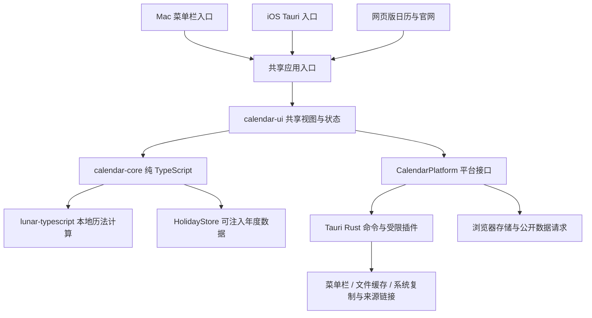

# 核心能力与界面边界

拾日历使用 Tauri 2 承载 Mac 与 iOS，共享 React 界面直接用于 Web。历法及调休规则仍只有一份 TypeScript 实现。

## 三层职责

| 层             | 位置                     | 负责内容                                 | 依赖限制                             |
| -------------- | ------------------------ | ---------------------------------------- | ------------------------------------ |
| 日历核心       | `packages/calendar-core` | 公农历、节气、节日、月历、调休校验及查询 | 无 UI、网络、文件系统和平台依赖      |
| 界面与应用状态 | `packages/calendar-ui`   | 六周网格、选日、偏好、更新流程、导入反馈 | 通过注入接口调用宿主，规则只调用核心 |
| 平台适配       | `apps/calendar`          | 浏览器/Tauri 启动、存储、网络和系统能力  | 不复制历法规则，不维护另一套月历界面 |

`CalendarController` 不依赖 React，以稳定快照和订阅接口供视图使用；保存操作串行执行，避免旧偏好覆盖新偏好。跨北京时间午夜时，跟随今天的选择继续跟随，手动浏览的日期保留。缓存失效时回退内置数据并显示原因。

Mac 使用系统 WKWebView，不携带 Chromium。Rust 只处理菜单栏、窗口位置、文件存储和固定来源的网络请求；iOS 复用相同入口与 `mobile_entry_point`，通过独立平台配置避免引入 Mac 菜单栏行为。Web 使用浏览器 localStorage、Fetch 和 Clipboard，不启动 Rust 服务端。

## 平台能力与权限

- Mac 菜单栏左键切换，右键提供打开、设置和退出；关闭与失焦收起窗口，进程常驻。
- 弹层按菜单栏位置与显示器物理坐标定位，并限制在屏幕内；原生选择器/导入面板期间暂停失焦收起。
- 原生状态只写入固定应用数据目录，采用大小限制、版本校验和原子替换；不开放通用文件系统或 shell 权限。
- 调休请求只接受年份，不接受任意 URL。Rust 固定请求 holiday-cn 的公开 JSON，设置超时及大小上限。
- 来源链接只允许 HTTPS，复制只授予写入文本能力。生产 CSP 限制脚本来源；开发 CSP 单独允许 Vite 热更新。
- 开发与本机构建流程不包含自动更新、统计、账户或遥测。

## 数据更新与迁移

应用初始化先载入内置完整年份，再校验并合并本地缓存。缺少新缓存时，Mac 尝试只读导入旧 Swift 版的调休文件和显示偏好；原文件不删除。已存在但损坏的新缓存不会被静默覆盖。

更新仅由用户触发，本年与次年并行获取，独立校验后合并。一个年份失败不丢弃另一个有效结果；网络失败不清空已有数据。JSON 校验只能证明结构与日期合法，维护者仍需核对完整年度通知。调休未收录时，常规周末与工作日不能表示最终休班安排。

## 构建与验证

`npm run build` 生成清理后的核心 ESM/声明与静态前端；Tauri 再将前端嵌入应用。不再生成 JavaScriptCore IIFE 或 Swift 桥接资源。前端依赖按 React、控件和历法库分包；应用与网页均随附第三方许可信息。

Mac 冒烟检查在真实 WKWebView 中渲染 42 格月历，调用共享核心核对春节农历及补班，然后通过 IPC 检查窗口显示、收起和重开。此检查不替代菜单栏鼠标、辅助功能或 iOS 验收。

iOS 当前完成架构入口、共享 UI 与构建配置接入；缺少完整 Xcode 和 CocoaPods，未生成可验证的 iOS Xcode 工程，也未编译模拟器或真机。提醒、农历生日、Widget、系统日历、账号同步和地方假期均不在当前实现范围。
