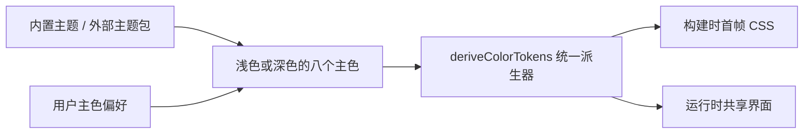

# 主题模型与派生规则

主题定义主色，生成器决定文字层级和交互状态，组件只消费渲染颜色。主题规则属于共享 UI，不进入公农历核心，不依赖网络、文件系统或平台 API。



## 主色与派生色

每种外观只定义八项：

| 字段      | 含义           | 主要派生结果                               |
| --------- | -------------- | ------------------------------------------ |
| `canvas`  | 页面背景       | 背景与控件的明度关系、说明文字校正         |
| `surface` | 卡片与弹层背景 | 控件底色、悬停、按下、分隔与浅底           |
| `ink`     | 主要文字基准   | 次要、农历、星期、说明、选中文字及月外层级 |
| `accent`  | 操作强调色     | 操作与选中、浅底、日期叶片、开关开启态     |
| `red`     | 休假与警告     | 可读语义文字、休假浅底及月外弱化           |
| `green`   | 节气与工作日   | 可读语义文字、工作日/宜浅底及月外弱化      |
| `yellow`  | 补班与提醒     | 可读语义文字、提醒浅底及月外弱化           |
| `purple`  | 节日           | 可读语义文字、节日浅底及月外弱化           |

八个主色是生成基准，文字和图形前景按真实背景校正；原始主色保持保存。黑白作为颜色混合与前景选择的算法端点，不属于额外的主题配置。背景明暗由实际卡片颜色判断，避免选择浅色外观却使用深背景时生成不可读文字。

预设只在 `packages/calendar-ui/src/theme-package.ts` 中提供主数据；`color-theme.ts` 的 `deriveColorTokens` 生成现有全部渲染颜色。`scripts/theme-css.ts` 在 PostCSS 构建时调用同一函数，为 `calendar.css` 的占位规则生成浅深色与增加对比度首帧样式。CSS 不另行手写派生色表，组件也不定义局部派生算法。

## 主题包契约

`CalendarThemePackage` 是纯 JSON 可表达的数据，包含：

- `schemaVersion`：数据结构版本，当前为 1。
- `rulesVersion`：派生规则版本，当前为 1。
- `id`、`name`、`version`：主题标识、显示名称和主题自身版本。
- 可选 `author`、`description`：作者与介绍元数据。
- `palettes.light`、`palettes.dark`：两套完整的八主色数据。

例如：

```json
{
  "schemaVersion": 1,
  "rulesVersion": 1,
  "id": "my-theme",
  "name": "我的主题",
  "version": "1.0.0",
  "palettes": {
    "light": {
      "canvas": "#f1f2f6",
      "surface": "#ffffff",
      "ink": "#303030",
      "accent": "#3269d9",
      "red": "#e51c3c",
      "green": "#00894f",
      "yellow": "#946200",
      "purple": "#8b4fc5"
    },
    "dark": {
      "canvas": "#171b23",
      "surface": "#222630",
      "ink": "#f3f3f3",
      "accent": "#3269d9",
      "red": "#ff8d9b",
      "green": "#72d6a1",
      "yellow": "#edc56b",
      "purple": "#c6a0ed"
    }
  }
}
```

`parseThemePackage` 校验完整主色、元数据与支持的版本，规范化色值并返回独立副本；不接受 CSS、脚本、资源、未知派生色字段或不支持的规则版本。内置主题同样遵循这个契约，JSON 往返后产生相同派生结果。

格式变化与视觉算法变化分别提高对应版本，接入新规则时必须同步迁移策略与回归样例。主题作者不需要复制客户端里的悬停、按下、浅底和文字对比算法。

## 偏好兼容

现有 `customColors` 仍保留启用开关及浅深色两套主色。CSS 角色名仅用作旧偏好适配，与主题包的独立字段通过映射关联。载入 1.0.3 的完整配色时，验证全部已知旧色值后仅保留八个主色，旧派生色不再影响生成结果；下一次正常保存只写主色，载入不会主动改写原文件。

编辑器始终使用基础主题保证恢复入口可读，预览与实际界面使用统一生成结果。关闭自定义保留选色；品牌 Logo 与 macOS 系统模板图标不属于主题包。

## 后续接入边界

本轮已提供数据契约、校验器与统一生成器，尚未提供主题文件导入/导出界面、远程主题安装、账号、作品分享或社区服务。

后续可以先在平台适配层接入文件读写，将 JSON 交给 `parseThemePackage`，再复用现有生成器；之后让社区分发同一份主题包及展示元数据。作者字段仅为展示信息，社区来源与审核由分发层负责。日历核心和颜色派生器无需因社区功能而依赖账号或网络。
